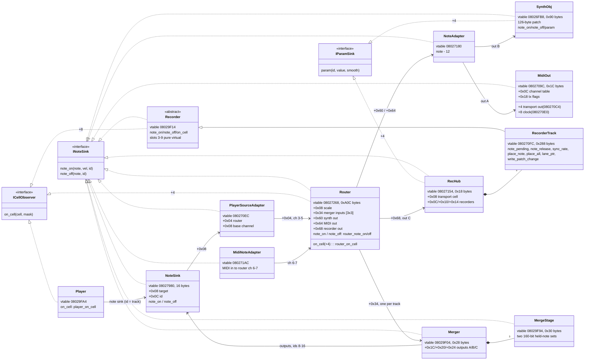
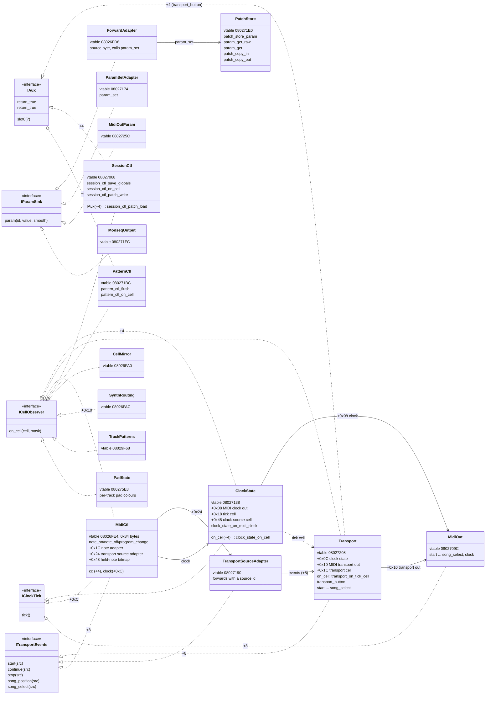

# Class diagram

The app is C++ with no symbols, so this diagram comes from the vtables
(`docs/source-map.md` *Data*, `src/symbols.tsv` `vt_*`), the constructors and the wiring in
`docs/sequencer.md`. Class names are ours, made from the vtable names. Interface names
(`I*`) are ours too. They stand for vtable layouts that several classes share:

- **Base offset:** a second or third base shows up as an extra vtable group, whose
  offset-to-top word (`0xfffffffc` = `this+4`, `…f8` = `+8`, `…f4` = `+0xC`, `…f0` = `+0x10`)
  gives the base's offset in the object. Its slots are `*_thunk` entries.
- **Slot order:** methods are listed in vtable slot order.
- **Uncertain names:** a `(?)` marks a name or a signature that is only a guess.
- **Not shown:** the RTTI words are all 0 (`-fno-rtti`), so the real class names and
  hierarchy are lost. Two classes that have the same layout may still be unrelated in
  the source.

## Shared interfaces

| Interface | Slots | Implemented by |
|---|---|---|
| `INoteSink` | `[0] note_on(note, vel, id)`, `[1] note_off(note, id)` | every note-path object below, `MidiCtl` |
| `ICellObserver` | `[0] on_cell(cell, dirty_mask)` (`cell_commit` calls it) | players, views, router, controllers |
| `IParamSink` | `[0] param(id, value, smooth)` | `ForwardAdapter`, `ParamSetAdapter`, `SynthObj +4`, `RecHub +4`, `MidiOutParam`, `ModseqOutput` |
| `ITransportEvents` | `[0] start [1] continue [2] stop [3] song_position [4] song_select` | `Transport +8`, `MidiCtl +8`, `TransportSourceAdapter` |
| `IClockTick` | `[0] tick()` | `MidiOut +8` (`midiout_clock_tick` sends `F8`), `ClockState` (`clock_state_on_midi_clock`), `MidiCtl +0xC` |
| `IAux (?)` | `[0]` one method, `[1]`/`[2]` default `return_true` | `Transport +4`, `SessionCtl +4`, `PatternCtl +4`, `GlideView +0x10`, `KeyboardView +0x10` |

## Note and parameter path

The note path from `docs/sequencer.md` *Note path*. Each link is labelled with the field
in the object that holds the pointer.

## Transport, MIDI control and parameters

`ClockState ..> Transport` is a cell subscription, not a pointer: the transport observes
the clock state's tick cell (`+0x18`). The players observe it too. `vt_bool_invert_adapter`
(`08027090`) and `vt_cell_deferred_notify` (`0802728C`) are one-slot objects whose
interface isn't known yet, so they are left out.

## Views

`View` (`vt_view_base`, `08027638`) has slots 0–9. The defaults are no-ops, except
`view_rgb_leds` and `view_mono_leds`. A view lists only the slots it overrides. Two
layouts derive from it, and both put an `ICellObserver` base at `+0xC`:

- **`ObservingView`:** slot 10 is `on_cell` (or render). `vt_container_view`
  (`08027BA4`) is this layout with slot 10 left pure (`__cxa_pure_virtual`).
  `ui_construct` later installs `vt_root_input_view` (`08027730`, slot 10 `return_1`) over the container view's vtable.
- **`LayeredView`:** slot 10 returns a constant (`return_0`/`_1`/`_3`; `mode_view_layer`
  in `ModeView`) and slot 11 is `on_cell`. What the constant means isn't known.

`UiRoot` is not a `View`. It has its own 8 input slots and `on_cell` at slot 8, with an
`ICellObserver` base at `+4`. It holds the root views by slot (`source-map.md` *Views*).
`ModeView` forwards input to one child view at a time.

```mermaid
classDiagram
  class ICellObserver {
    <<interface>>
    on_cell(cell, mask)
  }
  class IAux {
    <<interface>>
  }
  class View {
    <<abstract>>
    vtable 08027638
    0 pad_down
    1 pad_up
    2 button_down
    3 button_up
    4 encoder
    5 pot
    6 fader
    7 nop
    8 rgb_leds: view_rgb_leds
    9 mono_leds: view_mono_leds
  }
  class ObservingView {
    <<abstract>>
    vtable 08027BA4 (container view)
    10 on_cell / render = pure
  }
  class LayeredView {
    <<abstract>>
    10 slot10() constant
    11 on_cell
  }
  class UiRoot {
    vtable 08027B1C
    ui_root_pad_down
    ui_root_pad_up
    ui_button_event
    ui_root_button_up
    ui_root_slot4
    ui_root_pot
    ui_root_fader
    ui_root_nop
    on_cell: ui_root_on_cell
  }
  class ModeView {
    vtable 08027668
    pad_down: mode_view_press
    pad_up: mode_view_release
    rgb_leds: mode_view_redraw
    slot10: mode_view_layer
    on_cell: view_post_if_enabled
  }
  View <|-- ObservingView
  View <|-- LayeredView
  ICellObserver <|.. ObservingView : +0xC
  ICellObserver <|.. LayeredView : +0xC
  ICellObserver <|.. UiRoot : +4
  LayeredView <|-- ModeView
  UiRoot o-- View : root slots
  ModeView --> View : target
  class ModmatrixView {
    vtable 080272A0
    button_down: modmatrix_view_button
    encoder: modmatrix_view_slot4
    on_cell: modmatrix_view_on_cell
  }
  ObservingView <|-- ModmatrixView
  class PatchView {
    vtable 080272E0
    pad_down: patch_view_pads
    pad_up: patch_view_pad_up
    slot10: return_1_b
    on_cell: patch_view_on_cell
  }
  LayeredView <|-- PatchView
  class ModeButtonsView {
    vtable 08027324
    on_cell: mode_buttons_on_cell
  }
  ObservingView <|-- ModeButtonsView
  class DistView {
    vtable 0802739C
    button_down: dist_view_button
    pot: dist_view_pot
    on_cell: dist_view_on_cell
  }
  ObservingView <|-- DistView
  class Select3View {
    vtable 08027400
    pad_down: select3_view_pad_down
    slot10: return_0
    on_cell: select3_view_render_thunk
  }
  LayeredView <|-- Select3View
  class TempoView {
    vtable 08027444
    button_down: tempo_view_tap
    encoder: knob_value_adjust
    mono_leds: tempo_view_mono_leds
    on_cell: tempo_view_on_cell
  }
  ObservingView <|-- TempoView
  class EnvelopeView {
    vtable 08027484
    fader: envelope_view_fader
    on_cell: envelope_view_on_cell
  }
  ObservingView <|-- EnvelopeView
  class VelocityView {
    vtable 080274C4
    pad_down: velocity_view_pad_down
    on_cell: velocity_view_render
  }
  ObservingView <|-- VelocityView
  class ModseqLevelView {
    vtable 08027550
    pad_down: modseq_level_view_pad_down
    on_cell: modseq_level_view_render
  }
  ObservingView <|-- ModseqLevelView
  class HoldButtonView {
    vtable 080275F8
    button_down: hold_button_view_down
    button_up: hold_button_view_up
    on_cell: hold_button_view_render_thunk
  }
  ObservingView <|-- HoldButtonView
  class FlagLedView {
    vtable 080276B0
    on_cell: flag_led_render
  }
  ObservingView <|-- FlagLedView
  class FilterView {
    vtable 080276F0
    button_down: filter_view_button
    pot: filter_view_pot
    on_cell: filter_view_on_cell
  }
  ObservingView <|-- FilterView
  class LfoView {
    vtable 0802777C
    button_down: lfo_view_button
    pot: lfo_view_pot
    on_cell: lfo_view_on_cell
  }
  ObservingView <|-- LfoView
  class View14View {
    vtable 080277BC
    pad_down: select_inverted_index
    slot10: return_1_b
    on_cell: view_14_on_cell
  }
  LayeredView <|-- View14View
  class ScalesView {
    vtable 08027840
    pad_down: scales_view_pad_down
    rgb_leds: scales_view_rgb_leds
    slot10: return_1
  }
  View <|-- ScalesView
  class SessionsView {
    vtable 08027874
    pad_down: sessions_view_pad_down
    button_down: sessions_view_button
    slot10: return_1_b
    on_cell: sessions_view_on_cell
  }
  LayeredView <|-- SessionsView
  class ScaleRootView {
    vtable 080278B8
    pad_down: scale_root_view_pad_down
    on_cell: scale_root_view_on_cell
  }
  ObservingView <|-- ScaleRootView
  class KeytrackView {
    vtable 080278F8
    pad_down: keytrack_view_pad_down
    slot10: return_1
    on_cell: keytrack_view_render_thunk
  }
  LayeredView <|-- KeytrackView
  class PatternsView {
    vtable 0802793C
    pad_down: patterns_view_pad_down
    pad_up: patterns_view_pad_up
    slot10: return_3
    on_cell: patterns_view_on_cell
  }
  LayeredView <|-- PatternsView
  class ScaleTypeView {
    vtable 080279A0
    pad_down: scale_type_view_pad_down
    on_cell: scale_type_view_render
  }
  ObservingView <|-- ScaleTypeView
  class MixerView {
    vtable 080279E0
    pot: mixer_view_pot
    on_cell: mixer_view_on_cell
  }
  ObservingView <|-- MixerView
  class RecView {
    vtable 08027A20
    button_down: rec_view_button
    button_up: oneshot_post
    on_cell: rec_view_on_cell
  }
  ObservingView <|-- RecView
  class SettingsView {
    vtable 08027A60
    pad_down: settings_view_pad_down
    button_down: settings_view_button
    on_cell: settings_view_on_cell
  }
  ObservingView <|-- SettingsView
  class SaveView {
    vtable 08027ADC
    button_down: save_view_button
    on_cell: save_view_on_cell
  }
  ObservingView <|-- SaveView
  class ViewLedsView {
    vtable 08027B54
    slot10: return_1
    on_cell: view_leds_on_cell
  }
  LayeredView <|-- ViewLedsView
  class GateView {
    vtable 08027BEC
    pad_down: gate_view_pad_down
    on_cell: meter_leds_render
  }
  ObservingView <|-- GateView
  class StepView {
    vtable 0802AA94
    pad_down: step_view_pad_down
    pad_up: step_view_pad_up
    on_cell: step_view_on_cell
  }
  ObservingView <|-- StepView
  class GlideView {
    vtable 0802AAD4
    pad_down: glide_view_pad_down
    pad_up: glide_view_pad_up
    on_cell: glide_view_on_cell
  }
  ObservingView <|-- GlideView
  IAux <|.. GlideView : +0x10 (pad_send_level)
  class KeyboardView {
    vtable 0802AC1C
    pad_down: keyboard_view_pad_down
    pad_up: pad_release
    rgb_leds: view_led_ptr
    on_cell: keyboard_view_on_cell
  }
  ObservingView <|-- KeyboardView
  IAux <|.. KeyboardView : +0x10 (pads_flush_held)
  class OctaveView {
    vtable 0802AC6C
    on_cell: octave_view_render_thunk
  }
  ObservingView <|-- OctaveView
  class PatternSettingsView {
    vtable 0802ADB4
    pad_down: pattern_settings_pad_down
    rgb_leds: view_rgb_leds_b
    on_cell: pattern_settings_on_cell
  }
  ObservingView <|-- PatternSettingsView
  class OscView {
    vtable 0802ADEC
    button_down: view_ab_on_event
    pot: osc_view_pot
    on_cell: osc_view_on_cell
  }
  ObservingView <|-- OscView
```

